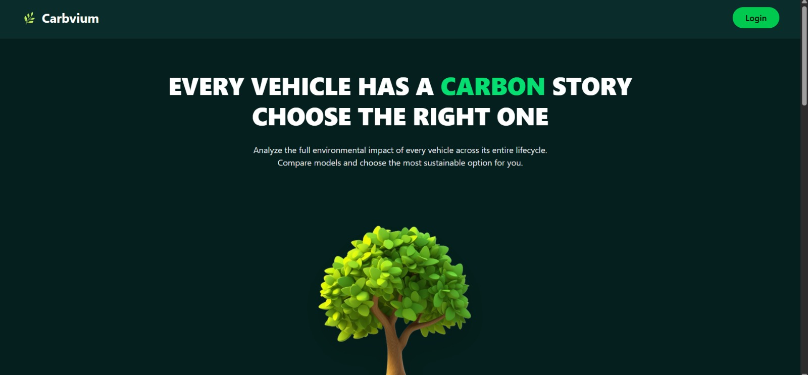
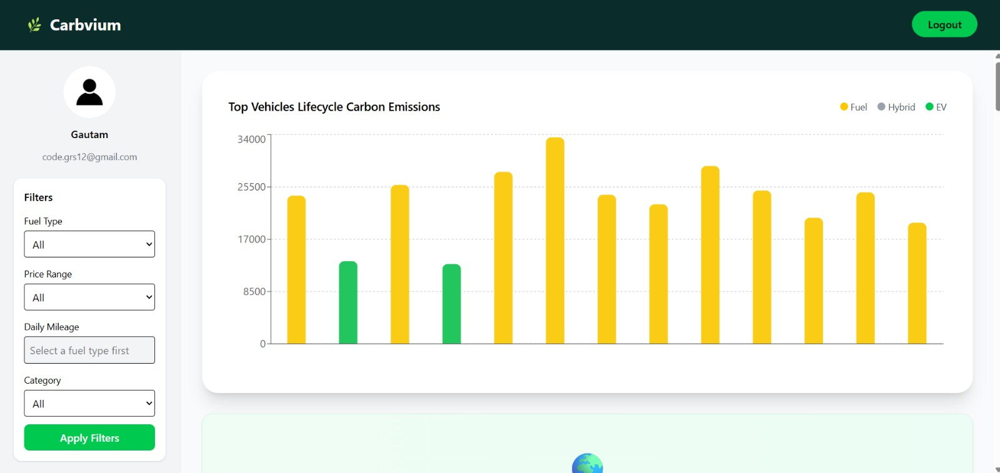
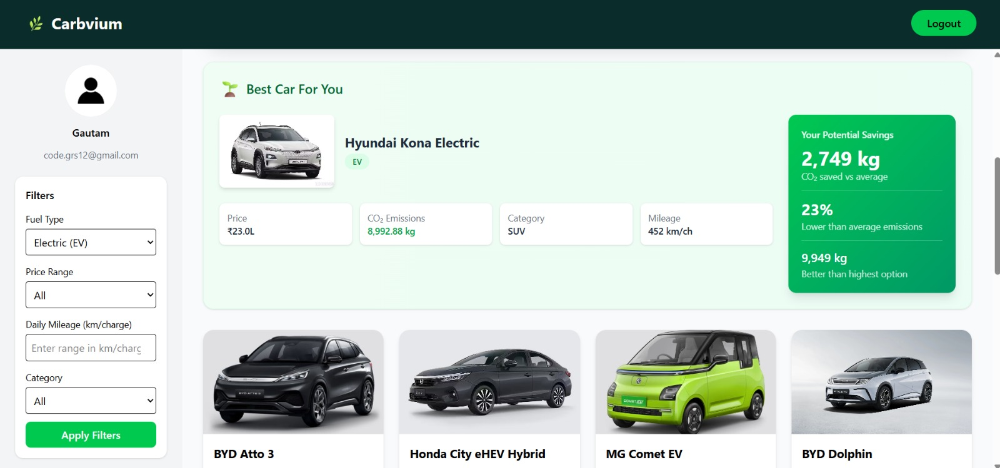
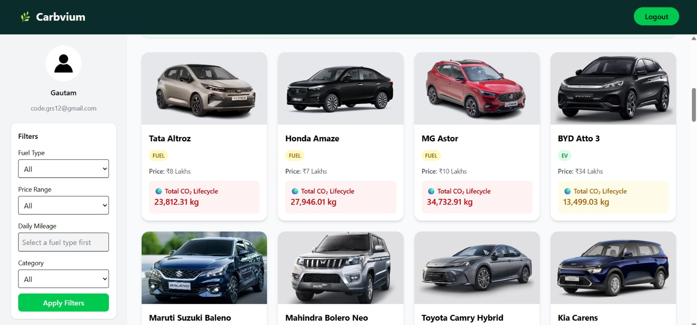
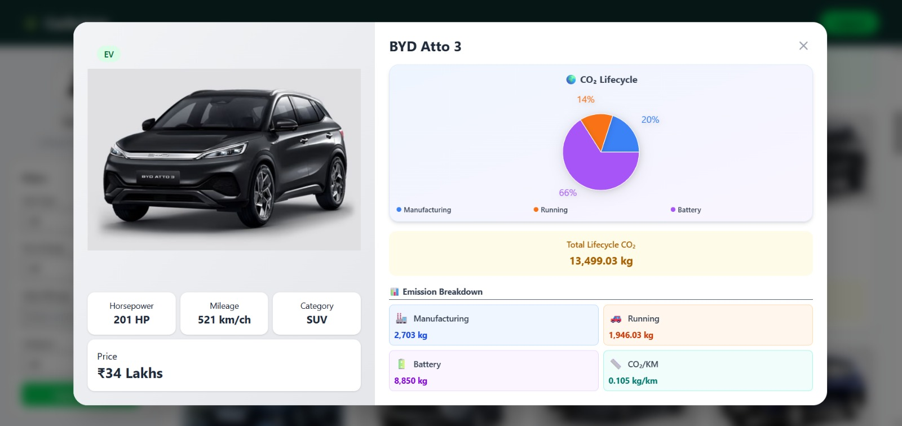
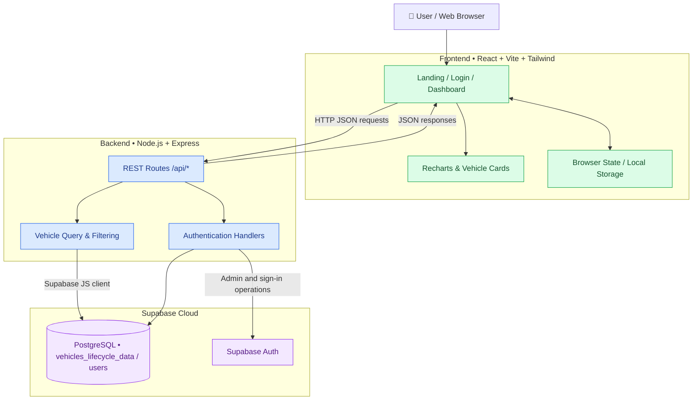
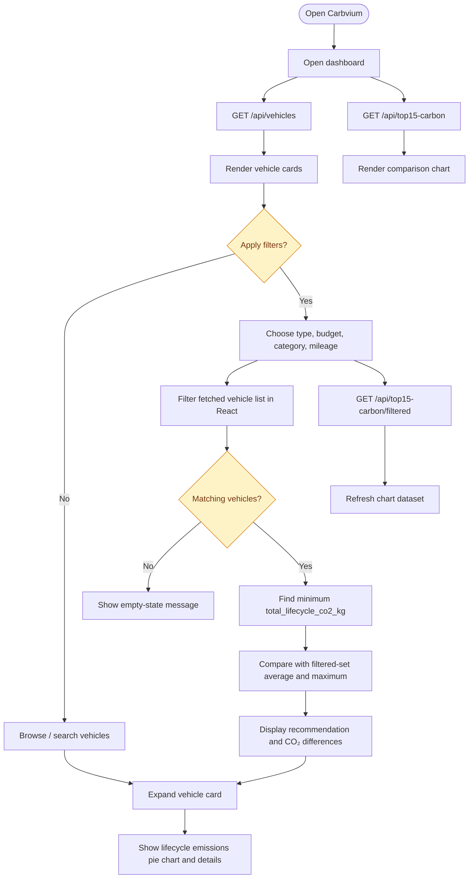
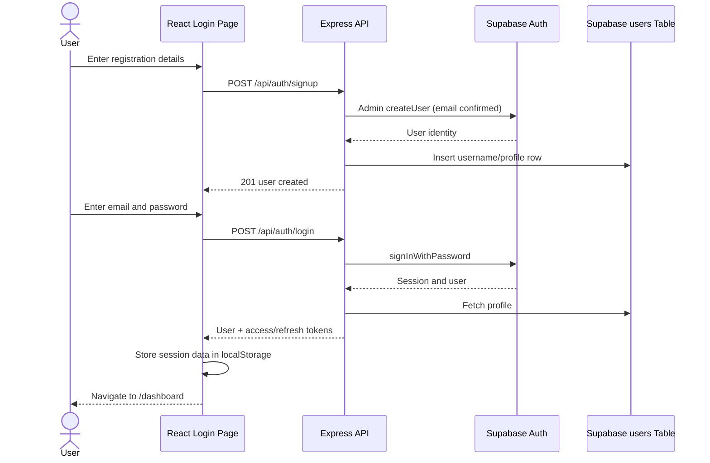
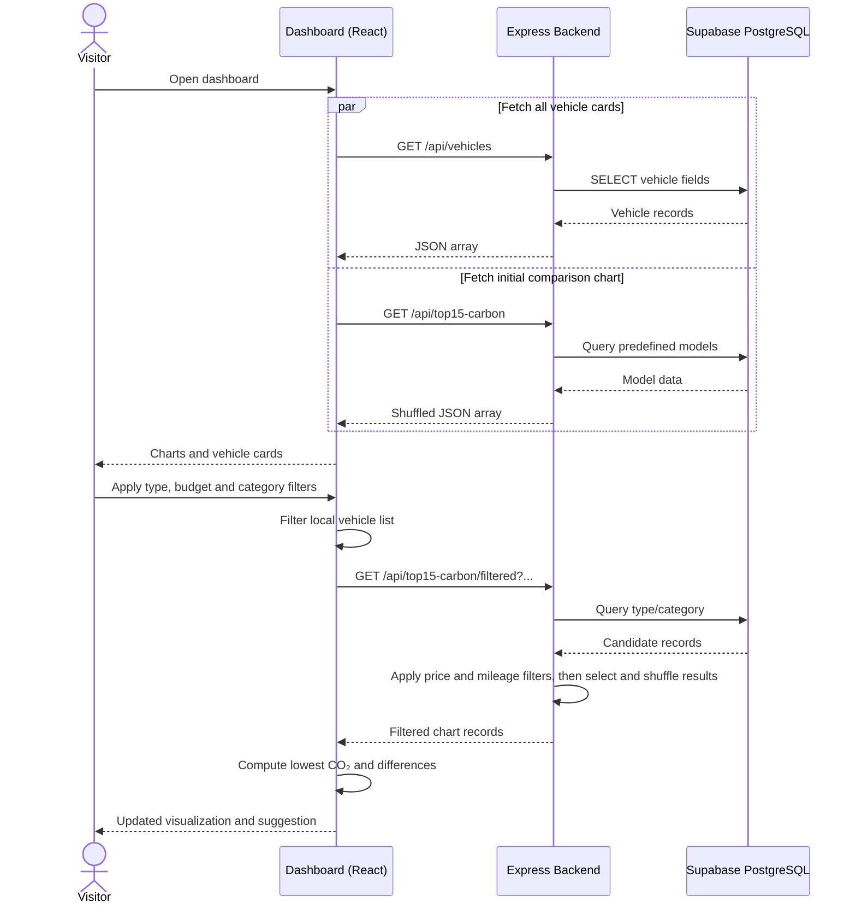

<div align="center">

# 🌿 CARBVIUM

### Every Vehicle Has a Carbon Story. Make Yours a Greener One.

**Explore · Compare · Understand · Choose Responsibly**

A full-stack web application for exploring and comparing the **lifecycle carbon emissions** of electric, hybrid, and conventional fuel-powered vehicles in the Indian automotive market.

[](https://carbvium.vercel.app/)
[](https://carbvium.onrender.com/)
[](LICENSE)


[**Live Demo**](https://carbvium.vercel.app/) · [**Features**](#-features) · [**Architecture**](#-system-architecture) · [**Quick Start**](#-getting-started) · [**API Reference**](#-api-reference) · [**Screenshots**](#-application-preview)

</div>

---

## 🌍 About the Project

When choosing a vehicle, purchase price and mileage are only part of the picture. **Carbvium** makes a vehicle's wider environmental impact easier to explore by displaying its available **manufacturing, battery, and running-stage CO₂ estimates** alongside its overall lifecycle emissions.

With an interactive dashboard, users can inspect vehicle specifications, narrow down candidates by practical preferences, compare carbon footprints visually, and discover the **lowest-emission model within the current filtered selection**.

> **Scope:** Carbvium is a comparison and visualization application built around existing vehicle lifecycle records stored in Supabase. The provided source does **not** train an ML model or calculate a new lifecycle assessment from raw manufacturing/energy inputs. Results depend on the completeness, assumptions, and quality of the underlying dataset.

## ✨ Features

| Capability | What it does |
|:--|:--|
| 🚗 **Vehicle discovery** | Browse vehicle cards with manufacturer, model, vehicle type, price, mileage, horsepower, and related attributes. |
| 🌱 **Lifecycle CO₂ insights** | Explore overall CO₂ emissions and available manufacturing, battery, and running-stage components. |
| 📊 **Interactive charts** | View vehicle emissions with Recharts bar charts and per-vehicle pie charts. |
| 🔎 **Search and filters** | Filter by EV/FUEL/HYBRID, price band, vehicle category, and minimum mileage/range (for a selected vehicle type). Search by vehicle name. |
| 🏆 **Low-emission suggestion** | Identify the lowest-lifecycle-CO₂ vehicle among cars matching the applied filters. |
| 📉 **Savings estimates** | Display differences between the recommended vehicle's CO₂ and the filtered-set average or highest-emitting option. |
| 🔐 **Accounts** | Create an account, log in, and log out using Supabase Auth behind the Express API. |
| 📱 **Responsive UI** | Responsive landing page, login screen, dashboard, and expandable vehicle cards. |
| 🐳 **Containerized setup** | Separate Node/Express and Nginx/React images managed by Docker Compose. |

> **How recommendations work:** The present implementation compares stored `total_lifecycle_co2_kg` values. It is **not** a learned AI recommendation engine. “CO₂ savings” means a difference between *dataset lifecycle estimates*; it is not a calculated annual real-world emission reduction.

## 🖼️ Application Preview

<details open>
<summary><b>🌱 Landing Page</b></summary>



</details>

<details open>
<summary><b>📊 Carbon Comparison Dashboard</b></summary>



</details>

<details>
<summary><b>🚘 Vehicle Recommendations and Exploration</b></summary>





</details>

<details>
<summary><b>🔍 Expandable Vehicle Details</b></summary>



</details>

## 🧰 Technology Stack

<div align="center">

| Layer | Technologies | Responsibility |
|:--|:--|:--|
| **Frontend** |  React 19 ·  Vite 7 ·  Tailwind CSS 4 | Components, bundling, responsive styling |
| **Navigation & UX** | React Router 7 · Framer Motion 12 · React Icons | Routing, animations, icons |
| **Visualization** | Recharts 3 | Emissions charts and graphical breakdowns |
| **Backend** |  Node.js ·  Express 5 | REST API, filters, auth handlers |
| **Data & authentication** |  Supabase ·  PostgreSQL | Hosted vehicle records and user accounts |
| **Development & operations** |  Docker ·  Nginx · Nodemon | Containerization, static serving, hot reload |
| **Deployment (documented)** | Vercel · Render | Frontend and backend hosting respectively |

</div>

### Core Dependencies

Versions below are the dependency **ranges specified in `package.json`**, not guarantees about installed transitive versions. For reproducible installs, use the committed lockfiles with `npm ci`.

| Frontend | Version range | Backend | Version range |
|:--|:--|:--|:--|
| `react`, `react-dom` | `^19.2.0` | `express` | `^5.2.1` |
| `vite` | `^7.3.1` | `@supabase/supabase-js` | `^2.97.0` |
| `tailwindcss` | `^4.1.18` | `cors` | `^2.8.6` |
| `react-router-dom` | `^7.13.0` | `dotenv` | `^17.3.1` |
| `recharts` | `^3.7.0` | `pg` | `^8.18.0` |
| `framer-motion` | `^12.34.3` | `nodemon` (dev) | `^3.1.13` |
| `react-icons` | `^5.5.0` | | |

`@tailwindcss/vite` and `@vitejs/plugin-react` integrate styling and React with Vite. The backend lists `pg`, but its shown request handlers use the **Supabase JavaScript client**, rather than directly making `pg` SQL queries.

## 🏗️ System Architecture



### 🔄 Vehicle Discovery & Recommendation Workflow



### 🔐 Authentication Sequence



> **Security note:** The sequence above reflects the existing implementation; it is not a production security endorsement. The current backend uses a privileged Supabase service-role client, and the frontend stores tokens in `localStorage`. See [Security & Limitations](#-security--known-limitations).

## 📁 Project Structure

```text
Carbvium/
├── Carbvium_Backend/
│   ├── auth.js                 # Signup, login, logout handlers
│   ├── server.js               # Express routes and filtering logic
│   ├── supabase_client.js      # Supabase service-role client
│   ├── .env.example            # Backend environment template
│   ├── Dockerfile              # Node 20 Alpine container
│   ├── package.json
│   └── package-lock.json
├── Carbvium_Frontend/
│   ├── src/
│   │   ├── pages/
│   │   │   ├── landing.jsx     # Landing page
│   │   │   ├── login.jsx       # Signup/login UI
│   │   │   ├── dashboard.jsx   # Search, filters, charts, recommendations
│   │   │   └── card.jsx        # Expandable vehicle detail card
│   │   ├── assets/             # Local illustrations/images
│   │   ├── App.jsx             # Client-side routes
│   │   ├── main.jsx            # React entry point
│   │   └── index.css           # Styling
│   ├── .env.example            # Frontend API base URL template
│   ├── Dockerfile              # Vite build + Nginx image
│   ├── nginx.conf              # SPA fallback and caching
│   ├── vercel.json             # Vercel rewrite configuration
│   ├── vite.config.js
│   ├── package.json
│   └── package-lock.json
├── screenshots/                # Five provided UI screenshots
├── docker-compose.yml         # Frontend/backend containers
├── requirements.txt           # Informational notes, not pip dependencies
├── LICENSE                    # GPL-3.0
└── README.md
```

## 🚀 Getting Started

### Prerequisites

- **Node.js 20+** and npm (Node 20 is also used by both Dockerfiles).
- **A Supabase project** with authentication enabled and the tables/schema described below.
- **Git** to clone the project.
- **Docker + Docker Compose plugin** (optional, for containerized installation).

> You do **not** need to run `pip install -r requirements.txt`. This is a JavaScript/Node.js application; the root `requirements.txt` contains informational setup notes rather than Python packages.

### 1. Clone the Repository

```bash
git clone <YOUR_REPOSITORY_URL>
cd Carbvium
```

Replace `<YOUR_REPOSITORY_URL>` with the actual GitHub clone URL.

### 2. Configure Supabase

In your Supabase project:

1. Copy the **Project URL** and relevant API credentials from the project dashboard.
2. Configure Supabase Authentication for email/password sign-in.
3. Create and populate the `vehicles_lifecycle_data` table and create the `users` profile table. **The ZIP does not contain a database migration, seed script, or vehicle-data export**, so obtain the actual schema/data from the project maintainers. The fields below are those **read by the backend**, not a complete executable database schema.

| Table | Fields referenced by the application |
|:--|:--|
| `vehicles_lifecycle_data` | `unique_id`, `company_name`, `model_name`, `vehicle_type`, `manufacturing_co2_kg`, `battery_co2_kg`, `running_co2_kg`, `total_lifecycle_co2_kg`, `lifecycle_intensity_kg_per_km`, `price_inr_lakhs`, `image_link`, `horsepower`, `mileage`, `category` |
| `users` | `id`, `email`, `username` |

The `users.id` value is populated using the Supabase Auth user's ID. A relational link to `auth.users(id)` is recommended for a full schema, but its existence could not be verified from the ZIP.

### 3. Backend Setup

```bash
cd Carbvium_Backend
npm ci
```

Create a `.env` file using the included template:

**Linux / macOS / Git Bash:**
```bash
cp .env.example .env
```

**Windows PowerShell:**
```powershell
Copy-Item .env.example .env
```

Set:

```dotenv
SUPABASE_URL=https://YOUR_PROJECT.supabase.co
SUPABASE_SERVICE_ROLE_KEY=YOUR_SERVICE_ROLE_KEY
SUPABASE_ANON_KEY=YOUR_ANON_KEY
PORT=5000
NODE_ENV=development
# Optional: replace defaults with a comma-separated allowlist
# ALLOWED_ORIGINS=http://localhost:5173,http://localhost:80
```

**Never commit a real `.env` file or share the service-role key.** This key must be used server-side only, never in a `VITE_` variable or browser bundle.

Start the API:

```bash
npm run dev
```

Expected local API URL: **http://localhost:5000**. Open that address to see the backend health text.

> The backend's `package.json` has `npm run dev` but does **not** define `npm start`. To run without Nodemon, use `node server.js`.

### 4. Frontend Setup

Open a **second terminal**, starting from the repository root:

```bash
cd Carbvium_Frontend
npm ci
```

Copy `.env.example` to `.env` as shown above, then configure:

```dotenv
VITE_API_URL=http://localhost:5000
```

Start the frontend:

```bash
npm run dev
```

Visit the URL printed by Vite (typically **http://localhost:5173**).

### 5. Other Useful Commands

```bash
# Run in Carbvium_Frontend/
npm run build      # Create production assets in dist/
npm run preview    # Preview the production bundle locally
npm run lint       # Run ESLint
```

## 🐳 Docker Deployment

The repository includes a two-service `docker-compose.yml`:

- **backend:** Node.js 20 + Express, published on port `5000`.
- **frontend:** Vite build served by Nginx, published on port `80`.

From the repository root, after creating `Carbvium_Backend/.env`:

```bash
docker compose up --build -d
docker compose ps
docker compose logs -f
```

| Service | Default address |
|:--|:--|
| Frontend | http://localhost |
| Backend | http://localhost:5000 |

Stop containers with:

```bash
docker compose down
```

**Important configuration caveat:** The provided frontend Dockerfile runs `npm run build` without accepting a `VITE_API_URL` build argument. Consequently, the bundled frontend uses the dashboard/login fallback of `http://localhost:5000` unless a build-time environment value is introduced. That works for a typical **local browser on the same machine**, but **will not automatically work for a remote Docker deployment**. For remote hosting, add a frontend Docker build argument / `ENV VITE_API_URL`, configure the actual public API origin, and rebuild the image. Docker Compose networking does not make the hostname `backend` resolvable inside a user's browser.

### 🚢 Production Hosting

The repository documents these deployments:

- **Frontend:** [Vercel – carbvium.vercel.app](https://carbvium.vercel.app/)
- **Backend:** [Render – carbvium.onrender.com](https://carbvium.onrender.com/)

The frontend references `import.meta.env.VITE_API_URL` with a localhost fallback. **Configure `VITE_API_URL` to the public backend URL in the frontend build environment** when deploying. Although `vercel.json` includes an `/api` rewrite, the current frontend directly constructs API URLs from `VITE_API_URL` and does not automatically use the rewrite when that value points elsewhere.

## 🔌 API Reference

Base URL (local): `http://localhost:5000`

| Method | Endpoint | Purpose |
|:--|:--|:--|
| `GET` | `/` | Basic server status text |
| `GET` | `/api/vehicles` | Retrieve the vehicle dataset ordered by model name |
| `GET` | `/api/vehicle/:uniqueId` | Get lifecycle fields for one vehicle |
| `GET` | `/api/top15-carbon` | Return matches from a predefined list of 15 model names, in shuffled order |
| `GET` | `/api/top15-carbon/filtered` | Filter records, take up to 15, and shuffle their display order |
| `POST` | `/api/auth/signup` | Register a user through Supabase Auth and insert a profile |
| `POST` | `/api/auth/login` | Sign in and return user information plus tokens |
| `POST` | `/api/auth/logout` | Request session sign-out with an access token |

### Filter Parameters

| Parameter | Examples | Behavior |
|:--|:--|:--|
| `vehicleType` | `EV`, `FUEL`, `HYBRID`, `all` | Exact type match unless `all` |
| `priceRange` | `low`, `mid`, `high`, `all` | Low `< ₹10 lakh`; mid `₹10–20 lakh`; high `> ₹20 lakh` |
| `category` | `SUV`, `Sedan`, `all` | Case-insensitive substring match |
| `mileage` | `20` | Minimum numeric mileage/range threshold |
| `mileageFuelType` | `ev`, `fuel_hybrid` | Required together with a positive `mileage` to activate backend mileage filtering |

The mileage value shares a dataset field for EV and fuel-powered vehicles; ensure you understand the source **units** before treating them as comparable.

**Examples**

```bash
curl http://localhost:5000/api/vehicles
curl http://localhost:5000/api/top15-carbon
curl "http://localhost:5000/api/top15-carbon/filtered?vehicleType=EV&priceRange=mid"
curl http://localhost:5000/api/vehicle/YOUR_UNIQUE_ID
```

**Sign up:**

```bash
curl -X POST http://localhost:5000/api/auth/signup \
  -H "Content-Type: application/json" \
  -d '{"username":"demo_user","email":"demo@example.com","password":"a-strong-demo-password"}'
```

**Login:**

```bash
curl -X POST http://localhost:5000/api/auth/login \
  -H "Content-Type: application/json" \
  -d '{"email":"demo@example.com","password":"a-strong-demo-password"}'
```

**Logout:** Send `{ "access_token": "YOUR_ACCESS_TOKEN" }` as a JSON body to `POST /api/auth/logout`. Avoid sharing actual tokens.

### ⚙️ Lifecycle Data Flow



## 📐 Emissions & Recommendation Logic

The application displays dataset-provided values:

- `manufacturing_co2_kg` — vehicle manufacturing-stage CO₂.
- `battery_co2_kg` — battery-related CO₂, where present.
- `running_co2_kg` — use/running-stage CO₂.
- `total_lifecycle_co2_kg` — reported lifecycle CO₂ total.
- `lifecycle_intensity_kg_per_km` — dataset-provided CO₂ intensity.

The vehicle card computes each displayed pie-slice percentage from the sum of the **available manufacturing, running, and battery components**. The full lifecycle total is read separately from the dataset rather than recomputed in the UI.

Within the currently filtered set, the dashboard chooses the record with the lowest available positive lifecycle CO₂ value and computes:

```text
Average CO₂           = sum(positive lifecycle CO₂ values) / count
Estimated CO₂ gap     = max(0, average CO₂ − recommended CO₂)
Percent below average = max(0, round(100 × CO₂ gap / average CO₂))
Gap vs highest        = max(0, highest lifecycle CO₂ − recommended CO₂)
```

These are **relative comparisons within selected database rows**, not independently validated lifecycle-science conclusions. The implementation has some missing-value edge cases; see the limitations below.

## 🔒 Security & Known Limitations

The following points are included to make the project reproducible and its current capabilities transparent:

1. **Protect Supabase credentials.** The ZIP includes a backend `.env` file. Do not publish it. If any real service-role key has ever been committed to a public Git repository, **rotate/revoke it** using your Supabase project controls and remove exposed secrets from repository history.
2. **Privileged backend access.** The server uses the Supabase **service-role key** for reads and admin auth operations. Never expose this key to the frontend, and add authorization/rate-limiting safeguards before public production use.
3. **Authentication enforcement.** The dashboard route currently has no React route guard, and vehicle APIs have no authentication middleware; having signup/login screens does **not** make all routes private.
4. **Session storage.** The login UI stores access and refresh tokens in browser `localStorage`; consider a more robust session strategy and an explicit frontend logout flow.
5. **Signup consistency.** If insertion into `users` fails after creating an Auth account, the backend currently logs the profile error but still reports successful signup. A more reliable registration flow should reconcile these states.
6. **Dataset setup not bundled.** The supplied ZIP contains no SQL migrations, vehicle-data import, or verified dataset provenance. New installations cannot populate the same comparisons from code alone.
7. **Not actually ranked top 15.** `/api/top15-carbon` matches a curated model list, and `/api/top15-carbon/filtered` takes up to 15 rows before shuffling. Neither endpoint sorts by CO₂ to return the true globally lowest 15.
8. **Filter/search behavior.** Search by name uses the full loaded vehicle list and is not explicitly combined with the other applied filters. The UI and backend also apply partly independent filters.
9. **CO₂ comparison caveats.** The recommendation chooses from available records and can behave unexpectedly with zero/missing emissions. A defensible environmental comparison requires consistent lifecycle boundaries, distance assumptions, and units across records.
10. **Deployment configuration.** Configure the frontend's API base URL at build time; additionally review CORS origin allowlists and HTTPS for your deployment.
11. **No test suite provided.** The backend's default `npm test` is a placeholder; frontend linting is configured, but automated end-to-end and API tests are not included.

## 🧭 Future Enhancements

- [ ] Add verified dataset citations, lifecycle assumptions, measurement units, and SQL migrations/seed scripts.
- [ ] Add robust auth guards, protected APIs, credential rotation and rate limiting.
- [ ] Implement true CO₂-ranked endpoints with deterministic pagination.
- [ ] Unify filtering and search behavior; add missing-value validation.
- [ ] Add side-by-side saved comparison lists and adjustable usage-distance assumptions.
- [ ] Add automated tests and CI/CD checks.
- [ ] Improve deployment-time API configuration and secure session handling.

## 🤝 Contributing

Contributions and constructive feedback are welcome.

```bash
git checkout -b feature/your-improvement
# Make changes and test the application
git add .
git commit -m "feat: describe your improvement"
git push origin feature/your-improvement
```

Then open a pull request describing your changes and how you validated them.

## 👥 Team

| Contributor | Project contribution (as documented in the existing README) |
|:--|:--|
| **Manas Tiwari** | DevOps, database and backend development |
| **Akhilesh Singh** | UI/UX, frontend and backend development |
| **Gautam Raj Singh** | Frontend and backend development |

## 📜 License

Distributed under the **GNU General Public License v3.0**. See [LICENSE](LICENSE) for the full text.

---

<div align="center">

### 🌎 Better comparisons begin with better information.

**Carbvium — Explore the carbon story behind every drive.**

[⬆ Back to Top](#-carbvium)

</div>
